# Bootstrap flows

What `kubeaid-cli cluster bootstrap` does, step by step, for each kind of cluster: single-node or HA, VPN or workload, HCloud, bare metal, AWS, Azure and local. Read it when a bootstrap is stuck and you need to know which step it is on and what that step is waiting for, or before changing the bootstrap code.

[architecture.md](architecture.md) gives the overview. This page goes one level down. Entry point: [pkg/core/bootstrap_cluster.go](../pkg/core/bootstrap_cluster.go).

## Table of contents

- [How the flow is chosen](#how-the-flow-is-chosen)
- [The whole flow](#the-whole-flow)
- [Phase 1 — Hetzner infrastructure](#phase-1--hetzner-infrastructure)
- [Phase 2 — Management cluster](#phase-2--management-cluster)
- [Phase 3 — Main cluster](#phase-3--main-cluster)
- [Phase 4 — Finish](#phase-4--finish)
- [Flows by cluster shape](#flows-by-cluster-shape)
- [What each wait needs](#what-each-wait-needs)

## How the flow is chosen

Everything is decided from `general.yaml`. These are the settings that change the flow:

| Setting | Values | What it changes |
| :--- | :--- | :--- |
| `cloud` provider | `local`, `bare-metal`, `aws`, `azure`, `hetzner` | Whether there is a management cluster, and how the main cluster is created (k3d, KubeOne or ClusterAPI). |
| `cloud.hetzner.mode` | `hcloud`, `bare-metal`, `hybrid` | Which Hetzner infrastructure is created first (HCloud network, vSwitch, rescue boot). |
| `cluster.type` | `vpn`, `workload` | A VPN cluster also runs Keycloak and NetBird, gets a pre-created control-plane load balancer, and has its public API access closed at the end. |
| `cluster.keycloak.mode` | `managed`, other | `managed` installs Keycloak and sets up its realm and clients for NetBird. |
| `cloud.hetzner.controlPlane.hcloud.replicas` and node groups | 1 and no HCloud node groups, or more | Single-node public versus HA. See below. |
| `cloud.hetzner.hcloudVPNCluster` | set or unset | A workload cluster that joins an existing VPN cluster's network. |
| `cloud.aws.eks`, `cloud.azure.aks` | `true` / `false` | Managed control plane: no control-plane nodes, and kubeaid-cli installs Cilium itself. |
| `cloud.disasterRecovery` | set or unset | Velero setup and the first backups. |
| `cluster.lockdown` | unset, `true`, `false` | Host-firewall lockdown on Hetzner bare metal: ask, run, or skip. |

The code reads these through small predicates in [pkg/config/predicates.go](../pkg/config/predicates.go):

| Predicate | True when |
| :--- | :--- |
| `HCloudSingleNodePublic()` | `mode: hcloud`, 1 control-plane replica, no HCloud node groups, no `hcloudVPNCluster`. Any `cluster.type`. |
| `VPNClusterEnabled()` | `cluster.type: vpn` with a `keycloak` block. |
| `ManagedKeycloakEnabled()` | VPN cluster with `keycloak.mode: managed`. |
| `CoturnFloatingIPEnabled()` | HCloud VPN cluster with more than 1 control-plane replica. |
| `ManagedControlPlaneEnabled()` | EKS or AKS. |
| `UsingHCloud()` / `UsingHetznerBareMetal()` | `hcloud` or `hybrid` / `bare-metal` or `hybrid`. |
| `shouldPreCreateControlPlaneLB()` | Not single-node public, and either `cluster.type: vpn` or `hcloudVPNCluster` set. |
| `netbird.OperatorEnabled()` | Every VPN cluster, and workload clusters with `cluster.netbird.dns` set. |

**Single-node versus HA on HCloud.** A cluster with 1 control-plane replica and no HCloud node groups is "single-node public". It gets no NAT gateway and no control-plane load balancer, and the one node sits on its own public IPv4, reached through the API DNS name. Anything bigger is HA-shaped: nodes sit on the HCloud private network, a NAT gateway gives them egress, and a load balancer fronts the API servers. A VPN cluster with more than one control plane also gets a floating IP for NetBird's Coturn.

## The whole flow

```mermaid
flowchart TB
  start(["cluster bootstrap"]) --> isHetzner{"Hetzner?"}

  isHetzner -- yes --> p1["Phase 1: Hetzner infrastructure<br/>network, SSH keys, NAT gateway,<br/>control-plane LB, vSwitch, rescue boot"]
  isHetzner -- no --> p2
  p1 --> p2

  p2{"Provider?"}
  p2 -- "bare-metal" --> kcfg["Phase 2: clone kubeaid-config,<br/>render KubeOne manifest<br/>(no management cluster)"]
  p2 -- "local, aws, azure, hetzner" --> mgmt["Phase 2: k3d management cluster,<br/>Sealed Secrets, ArgoCD,<br/>ClusterAPI providers, capi-cluster sync"]

  mgmt --> isLocal{"local?"}
  isLocal -- yes --> p4
  isLocal -- no --> capi["Phase 3: ClusterAPI creates the cluster<br/>(first control plane runs kubeadm init,<br/>then installs Cilium and the CCM)"]
  kcfg --> kubeone["Phase 3: kubeone apply"]

  capi --> waits["Wait: Cluster Provisioned and Ready,<br/>control-plane and worker Machines have Nodes"]
  waits --> save["Save main kubeconfig"]
  kubeone --> save

  save --> cni{"EKS or AKS?"}
  cni -- yes --> ciliumcli["kubeaid-cli installs Cilium"]
  cni -- no --> netready["Wait: control-plane Node networking ready"]
  ciliumcli --> sched
  netready --> sched{"Any node groups?"}
  sched -- no --> untaint["Remove NoSchedule taint<br/>from control-plane nodes"]
  sched -- yes --> worker["Wait: one worker node ready"]
  untaint --> setupmain
  worker --> setupmain

  setupmain["Main cluster setup: Sealed Secrets<br/>(keys copied from management),<br/>ArgoCD, root, secrets, cert-manager"]
  setupmain --> pivot{"ClusterAPI and<br/>not --skip-clusterctl-move?"}
  pivot -- yes --> move["clusterctl move<br/>(cluster manages itself)"]
  pivot -- no --> p4
  move --> p4

  p4["Phase 4: sync all ArgoCD apps<br/>(VPN apps in a fixed order),<br/>backups, VPN checks"]
  p4 --> gate{"NetBird API key<br/>available?"}
  gate -- "yes, or no NetBird" --> lock["Lockdown (Hetzner bare metal only),<br/>then close the LB's public interface<br/>(VPN and VPN-joined only)"]
  gate -- "operator defers" --> done
  lock --> done(["Next-steps panel"])
```



## Phase 1 — Hetzner infrastructure

Only for Hetzner. Code: [pkg/cloud/hetzner/prerequisite_infrastructure.go](../pkg/cloud/hetzner/prerequisite_infrastructure.go). Each step reuses what already exists, so a re-run picks up where the last one stopped.

| Step | Runs when |
| :--- | :--- |
| Register the Robot SSH key | Bare metal or hybrid |
| Boot every bare-metal server into rescue (in parallel, about 1–2 minutes each) | Bare metal or hybrid |
| Generate storage plans from the disks found | Bare metal or hybrid |
| Create the HCloud network | HCloud or hybrid |
| Register the HCloud SSH key | HCloud or hybrid |
| Create the NAT gateway and wait until it accepts SSH | HCloud or hybrid, except single-node public |
| Create the control-plane load balancer, then wait for the operator's DNS A record for the API name | `shouldPreCreateControlPlaneLB()`: VPN clusters and VPN-joined workload clusters |
| Allocate the Coturn floating IP | `CoturnFloatingIPEnabled()`: HA HCloud VPN clusters |
| Create the vSwitch, connect it to the HCloud network (hybrid), attach the bare-metal servers | Bare metal or hybrid |
| Attach the VPN cluster's servers to this cluster's network | `hcloudVPNCluster` set |

Other HA workload clusters don't get a pre-created load balancer; ClusterAPI's Hetzner provider (CAPH) creates and manages theirs.

## Phase 2 — Management cluster

Code: [pkg/core/create_dev_env.go](../pkg/core/create_dev_env.go) and [pkg/core/setup_cluster.go](../pkg/core/setup_cluster.go).

1. AWS only: create the IAM CloudFormation stack.
2. Clone the kubeaid-config repo.
3. Bare metal stops here: it renders the KubeOne manifest and moves on to phase 3.
4. Create the local k3d management cluster.
5. Set it up (`SetupCluster` with the management cluster type):
   1. Create the namespaces the apps need.
   2. Install the Sealed Secrets controller and check it is healthy.
   3. Render the templates into kubeaid-config, commit, and wait for the PR to be merged.
   4. Install ArgoCD.
   5. Sync `root` (only the apps the management cluster needs), then `secrets`, then `cert-manager`.
   6. Azure only: install Crossplane; on the management cluster also create the OIDC provider for Workload Identity.
   7. ClusterAPI clouds: sync `cluster-api-operator`, then the infrastructure provider (CAPA, CAPZ or CAPH), and wait for its controller pod.
   8. Sync `capi-cluster`. This creates the `Cluster`, `Machine` and provider resources, and the cloud starts building the main cluster.

For `local`, the k3d cluster is the main cluster, so phase 3 is skipped.

## Phase 3 — Main cluster

### 3.1 Create it

| Provider | How |
| :--- | :--- |
| `local` | Nothing to do. |
| `bare-metal` | `kubeone apply` on the given servers. Its kubeconfig becomes the main kubeconfig. |
| Hetzner, AWS, Azure | ClusterAPI. On Hetzner bare metal with a failover IP, the IP is first pointed at the first control-plane node. |

### 3.2 What the first control-plane node does

ClusterAPI clusters with kubeadm (everything except EKS and AKS) install their own CNI and cloud controller from the node. KubeAid's `capi-cluster` chart puts these steps in the `KubeadmControlPlane`'s `postKubeadmCommands`. Only the node that ran `kubeadm init` runs them:

1. Install Helm and clone KubeAid at the configured version.
2. Read the API server host and port from `admin.conf`.
3. Render KubeAid's Cilium chart with kube-proxy replacement, pointed at that API server, and apply it.
4. Render and apply the Hetzner cloud controller manager (`ccm-hcloud` for HCloud nodes, `ccm-hetzner` for bare metal).

The cluster has no kube-proxy, so the in-cluster API address (`10.96.0.1`) only works once Cilium runs. The CCM sets each node's IP addresses and provider ID and removes the `node.cloudprovider.kubernetes.io/uninitialized` taint. See [What each wait needs](#what-each-wait-needs) for why this order matters.

On EKS and AKS there are no control-plane nodes, so kubeaid-cli installs Cilium itself after the cluster is up (step 3.3).

### 3.3 Waits before using the cluster

1. **Provisioned**: the `Cluster` is Provisioned and Ready, at least one control-plane `Machine` is Running with a Node, and, if there are workers, at least one worker `Machine` is too. Then the main kubeconfig is saved.
2. **Networking**: on EKS and AKS, kubeaid-cli installs Cilium. Everywhere else it waits until the control-plane Nodes are Ready and their `NetworkUnavailable` condition is False.
3. **Schedulable**: with no node groups, the control-plane `NoSchedule` taint is removed so workloads can run there. Otherwise kubeaid-cli waits for one worker node.
4. **Settled**: ClusterAPI only. Waits for any control-plane rollout to finish, so installs don't land mid-rollout.

### 3.4 Set up the main cluster

`SetupCluster` with the main cluster type does the same as on the management cluster, with these differences:

- The Sealed Secrets keys are copied from the management cluster first, so the SealedSecrets already in kubeaid-config still decrypt.
- `root` creates every app, not only the management subset.

### 3.5 Pivot and extras (ClusterAPI only)

1. `clusterctl move`, unless `--skip-clusterctl-move` is set or it already ran. It first waits until every `Machine` is Running with a Node. On AWS (not EKS), CAPA's static credentials are zeroed first so it uses the nodes' instance profile.
2. AWS and Azure workload clusters (not VPN, not AKS): sync `cluster-autoscaler`.
3. Everything except Hetzner and AKS: sync `snapshot-controller`.

## Phase 4 — Finish

1. **Hetzner**: apply the `kube-system/cloud-credentials` Secret directly, so the CCM can start before the Sealed Secrets controller is up.
2. **Disaster recovery**, if configured: set up Velero. A disaster-recovery run stops here and restores the latest backup instead.
3. **Sync all ArgoCD apps.** VPN clusters sync these first, in this order, each waiting for the step after it:

    ```mermaid
    flowchart LR
      ccm["ccm-hcloud / ccm-hetzner<br/>(Hetzner)"] --> traefik["traefik"]
      traefik --> dns["wait: ingress LB IP<br/>and operator DNS"]
      dns --> cm["cert-manager"]
      cm --> cnpg["cloudnative-pg"]
      cnpg --> kc["keycloakx<br/>(managed Keycloak)"]
      kc --> kcwait["wait: keycloak-tls Ready,<br/>set up realm and clients"]
      kcwait --> nb["netbird"]
      nb --> nbwait["patch postgres DSN,<br/>wait: netbird-tls Ready"]
      nbwait --> rest["all other apps"]
    ```

    The Traefik and CCM steps only apply on Hetzner, and the Keycloak steps only with managed Keycloak. Other clusters sync every app in ArgoCD's order. `--skip-monitoring-setup` leaves out the monitoring apps.
4. **First backups**, with disaster recovery: an `init` Velero backup and the Sealed Secrets backup CronJob.
5. **VPN checks**, VPN clusters with managed Keycloak: read the Keycloak admin password for the panel, and check that the Keycloak realm, NetBird dashboard and NetBird API answer.
6. **NetBird API key**, clusters that run the NetBird operator: the operator's Pod webhook blocks Pod creation until `netbird-mgmt-api-key` exists. kubeaid-cli asks you to paste the key, wait, or defer. Deferring skips the next two steps, because without the mesh you would lose your only way to the API server.
7. **Lockdown**, Hetzner bare metal or hybrid after the pivot: the host-firewall lockdown. `cluster.lockdown` decides whether it asks, runs, or skips.
8. **Close the load balancer's public interface**, last: only when the load balancer was pre-created in phase 1 (VPN and VPN-joined clusters) and an API hostname is set. From now on the API is reached over NetBird.
9. Print the next-steps panel.

## Flows by cluster shape

### HCloud, single node (public)

`mode: hcloud`, 1 control-plane replica, no node groups.

- **Phase 1:** network and SSH key only. No NAT gateway, no load balancer.
- **The node:** a public IPv4, reached through the API DNS name. The `capi-cluster` values use `network.type: public`, so there's no private network.
- **Phase 3:** with no node groups, the control-plane taint is removed and everything runs on the one node.
- **Phase 4:** nothing to close at the end, because there's no pre-created load balancer.

### HCloud, HA (private network)

More than 1 control-plane replica, or HCloud node groups.

- **Phase 1:** network, SSH key and NAT gateway. A workload cluster's load balancer comes from CAPH; VPN and VPN-joined clusters pre-create it (see below).
- **Nodes:** on the private network (`network.type: private`), with `eth0` public and `enp+` private. They egress through the NAT gateway.
- **Phase 3:** the first control plane runs `kubeadm init`; the others join through the load balancer. The rollout wait (3.3, step 4) covers the rest joining.

### VPN cluster (`cluster.type: vpn`)

On top of the HCloud flow for its size:

- **Phase 1:** the control-plane load balancer is created up front with a public interface, and bootstrap waits for your DNS A record for the API name. HA VPN clusters also get the Coturn floating IP.
- **Phase 2/3:** extra namespaces and apps (Traefik, cert-manager, CloudNativePG, Keycloak, NetBird, NetBird operator).
- **Phase 4:** the ordered app sync, the endpoint checks, the NetBird API-key step, and finally closing the load balancer's public interface. After that, see [post-bootstrap.md](post-bootstrap.md).

Single-node VPN clusters follow the single-node shape (no NAT gateway, no load balancer), so they have nothing to close at the end.

### Workload cluster joining a VPN (`hcloudVPNCluster` set)

- **Phase 1:** the control-plane load balancer is pre-created (public while bootstrap runs), and the VPN cluster's servers are attached to this cluster's network.
- **Phase 4:** if `cluster.netbird.dns` is set, the NetBird operator is installed and the NetBird API-key step runs. The load balancer's public interface is closed at the end, the same as for a VPN cluster.

### Hetzner bare metal and hybrid

- **Phase 1:** Robot SSH key, rescue boot, storage plans, vSwitch. Hybrid also creates the HCloud network and connects the vSwitch to it.
- **Phase 3:** with a failover IP, it is pointed at the first control-plane node before the wait.
- **Phase 4:** Rook Ceph only renders with enough bare-metal workers. The lockdown step runs after the pivot.

### Bare metal (KubeOne)

- **No phase 1, no management cluster:** phase 2 only clones kubeaid-config and renders the KubeOne manifest.
- **Phase 3:** `kubeone apply` builds the cluster. There's no ClusterAPI, so no pivot.

### AWS and Azure

- **AWS:** the IAM CloudFormation stack in phase 2. CAPA switches to instance profiles at the pivot, except on EKS.
- **Azure:** Crossplane and the Workload Identity OIDC provider in phase 2.
- **EKS / AKS:** no control-plane nodes, so kubeaid-cli installs Cilium itself in 3.3.
- **Workload clusters on both** also get `cluster-autoscaler` (not AKS, which scales its own agent pools).

### Local

The k3d cluster is the main cluster: phase 2 sets it up and phase 4 syncs the apps. No phase 1 or 3.

## What each wait needs

When a bootstrap stops moving, find the step it's on in the run's log (`~/.config/kubeaid-cli/<cluster>/logs/`, newest file) and check what that wait needs:

| Wait | Needs | Usually stuck because |
| :--- | :--- | :--- |
| NAT gateway reachable | SSH to the NAT gateway as `root` with the cluster's SSH key | The server exists from an earlier run but holds a different key, or the YubiKey touch was missed. |
| Control-plane DNS | Your A record for the API name points at the load balancer's public IP | The record isn't there yet, or points at an old IP. |
| Infrastructure provider pod | The CAPA/CAPZ/CAPH controller pod runs in the management cluster | Image pull, RBAC, or a missing namespace; the log prints the provider's failing condition every 20 seconds. |
| Cluster provisioned | Each `Machine` is matched to a Node. ClusterAPI matches them by provider ID, which the CCM sets. | The CCM can't start. It needs the API server, which it reaches through `10.96.0.1`, which needs Cilium. If Cilium can't start either, neither moves (see below). |
| Control-plane networking | The Node is Ready and `NetworkUnavailable` is False | Cilium isn't running on the node. |
| One worker ready | A worker Node is Ready | Workers can't join or reach the API server. |
| Ingress LB DNS (VPN) | Your DNS for Keycloak and NetBird points at Traefik's load balancer IP | The records aren't there yet. |
| keycloak-tls / netbird-tls (VPN) | cert-manager issued the certificates | DNS doesn't point at the ingress load balancer yet, so the ACME HTTP-01 check fails. |

**Cilium and the CCM can block each other.** On a fresh HCloud node on a private network, Cilium's device list matches both `eth0` and `enp+`. It picks the direct-routing device by the Node's IP, which the CCM hasn't set yet, so it exits with `unable to determine direct routing device`. The CCM, in turn, times out on `10.96.0.1` because Cilium isn't running. To check, read the pod logs on the node itself, because the kubelet can't serve logs until the node has an IP:

```sh
ssh -i <sshKeyPair.privateKeyFilePath> root@<node public IP> \
  'tail -n 50 /var/log/pods/cilium_cilium-*/cilium-agent/*.log; tail -n 50 /var/log/pods/kube-system_ccm-hcloud-*/*/*.log'
```

The fix belongs in KubeAid's `capi-cluster` chart: leave `eth0` out of Cilium's devices on private networks, so Cilium has a single device to use and comes up without the CCM.
