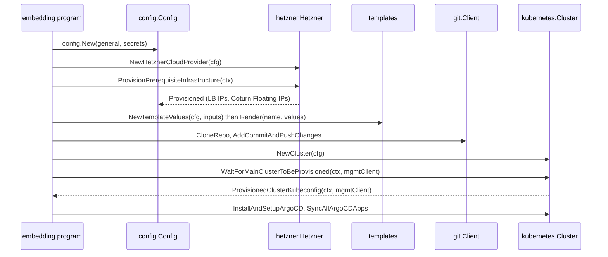

# Using the packages as a library

## Overview

`pkg/cloud/hetzner`, `pkg/utils/kubernetes`, `pkg/utils/git` and `pkg/templates` can be imported
by a long-running program that reconciles several clusters at once, such as an operator. The
`kubeaid-cli` commands use the very same packages; they just feed them from the files they parse.

## Purpose

A process-wide `config.ParsedGeneralConfig` and a `os.Exit` on every failed step suit a CLI that
handles one cluster and then ends. Neither suits a controller. So the library packages:

- read one explicit `*config.Config` per cluster, never the parsed-config or `globals` variables;
- return errors, never exit. `pkg/utils/assert` is import-restricted (`.golangci.yaml`, rule
  `no-assert-in-library-code`) to `cmd/`, `pkg/core/`, the config parser `pkg/config/parser`,
  `MustGetEnv` / `MustSetEnv` in `pkg/utils/others.go`, and `tools/`.

## Behavior

| Package | Entry point | Per-cluster state it keeps |
| --- | --- | --- |
| `pkg/config` | `config.New(general, secrets)` | the `Config` itself, including `Provisioned` |
| `pkg/cloud/hetzner` | `hetzner.NewHetznerCloudProvider(cfg, opts...)` | vSwitch ID, SSH connection pool |
| `pkg/utils/kubernetes` | `kubernetes.NewCluster(cfg)` | the ArgoCD application client |
| `pkg/utils/git` | `git.New(cfg)` | none |
| `pkg/templates` | `NewTemplateValues`, `NonSecretTemplateNames`, `SecretTemplateNames`, `Render` | none, no I/O |

Failures from `pkg/utils/git` and `pkg/utils/templates` are a `*git.Error` / `*templates.Error`:
a headline, which the CLI prints when it exits on the error, plus the cause and, for git, the log
attributes of the operation (the repository, branch or ref). `NewCluster`,
`NewHetznerCloudProvider` and `NewTemplateValues` return an error for a config that lacks what
they need.

## Configuration

`config.Config` holds `General` and `Secrets` (used in place: provisioning hydrates them, and the
caller reads the result back), `CloudProviderName`, `CAPIClusterNamespace` (empty means
`capi-cluster`; an embedder may set `capi-cluster-demo01`) and `Provisioned`.

Building `General` and `Secrets` without the CLI means doing what `parser.ParseConfigFiles` does
between unmarshalling the files and validating them: apply the struct defaults, default the
KubeAid Config directory to the cluster name, parse `Forks.*.ParsedURL`, load `Git.CABundle`,
hydrate the SSH key pairs, the audit-logging, Keycloak, NetBird and KubePrometheus defaults and the
VM specs, and fill the generated secrets (`FillMissingSecrets`; without them the NetBird and
Keycloak keys render empty). That is the caller's job; `config.New` does none of it.

Inputs the packages take instead of reading ambient state:

| Input | Where |
| --- | --- |
| management-cluster client | every `kubernetes.Cluster` wait and `hetzner.PointFailoverIPToInitMasterNode` |
| main-cluster kubeconfig | `Cluster.ProvisionedClusterKubeconfig` returns it; `Cluster.GetMainClusterEndpoint` and `kubernetes.CreateKubernetesClient` take a path, `CreateKubernetesClientFromConfig` a `*rest.Config` |
| lookups for the templates (cloud, cluster, files) | `templates.Inputs` |
| bare-metal storage plan approval | `hetzner.WithStoragePlanApprover`; without it the plans are rejected |

## Edge cases

- A `Config`, a `Hetzner` and a `Cluster` belong to one cluster and are not safe for concurrent use.
- `Provisioned` lives in memory. Restore it from your own record after a restart, or re-run
  `ProvisionPrerequisiteInfrastructure`, which resets it and recomputes it. Re-running is safe
  for HCloud. For bare-metal it rescue-boots and hardware-resets every host that fails one SSH
  probe, a live node that is briefly unreachable included, so it does not belong in a reconcile
  loop over hosts that already are nodes.
- Still ambient, and so not safe for several clusters in one process:
  - `$KUBECONFIG` (else `~/.kube/config`), read by the Helm SDK (`HelmInstall*`,
    `HelmRenderManifest`, `InstallSealedSecrets`, `ReinstallSealedSecrets`, so also
    `EnsureSealedSecretsHealthy`), `SealIfPlaintextChanged`, `GenerateSealedSecret`,
    `CreateRESTConfig`, `CreateClientset` and `CreateUnstructuredClient`.
  - The ArgoCD connection of `ConnectArgoCD` / `InstallAndSetupArgoCD`: the port-forward goes
    through argo-cd's default kubeconfig loading, argo-cd also reads `ARGOCD_SERVER`,
    `ARGOCD_AUTH_TOKEN` and `~/.config/argocd/config`, and the forward runs until the process
    ends: `CloseArgoCD` closes only the gRPC connections.
  - `HELM_DRIVER`, and `SSH_AUTH_SOCK` for the SSH connections to the bare-metal hosts.
  - The flags of the yq command that `Hetzner.UpdateCapiClusterValuesFile` drives, which yq keeps
    in package variables.
  - The working tree and `known_hosts` of `pkg/utils/git` sit under a fixed temp directory,
    shared by clusters that share a repository or have different `known_hosts`.
- `WaitFor*` in `pkg/utils/kubernetes` and `WaitForDNSResolution` render a live terminal table
  and block for minutes, and `WaitForMainClusterToBeProvisioned` leaves a goroutine polling until
  its context ends. A reconciler should instead read `Cluster.GetClusterResource` and the
  Machines of the CAPI namespace on each pass.
